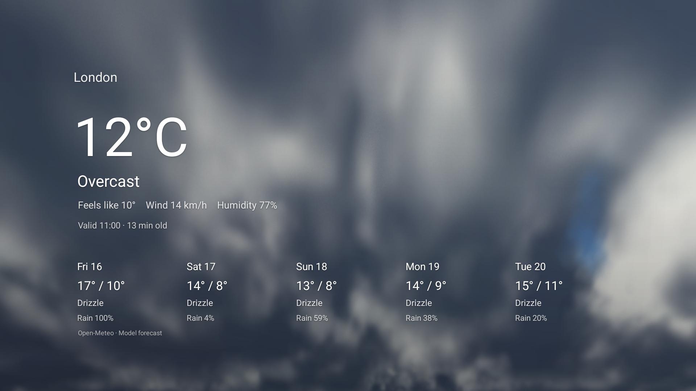
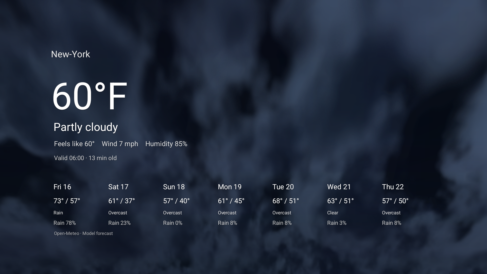
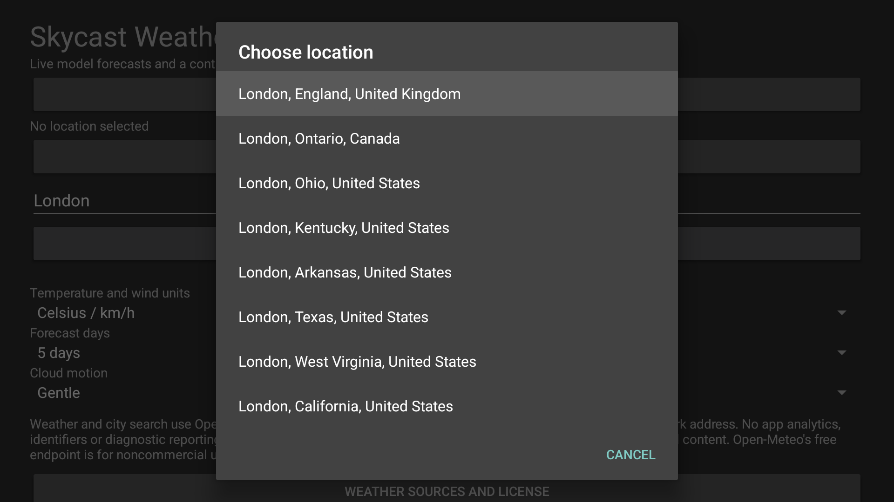
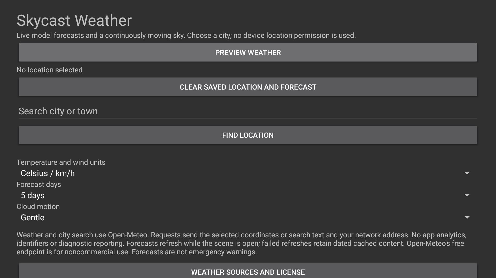
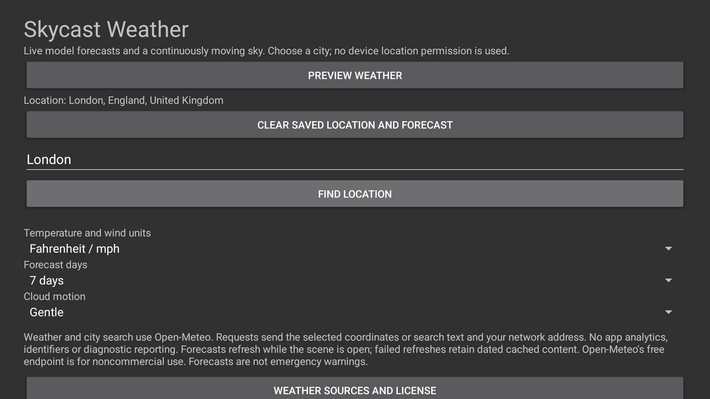

  <a href="https://github.com/jeremykenedy/skycast-weather#gh-light-mode-only"><picture><source media="(max-width: 600px) and (prefers-reduced-motion: reduce)" srcset="art/banner-mobile-still-light.22e19367bf54.svg"><source media="(prefers-reduced-motion: reduce)" srcset="art/banner-still-light.3d702736cede.svg"><source media="(max-width: 600px)" srcset="art/banner-mobile-light.bc5c046bcba7.svg"></picture></a>
  <a href="https://github.com/jeremykenedy/skycast-weather#gh-dark-mode-only"><picture><source media="(max-width: 600px) and (prefers-reduced-motion: reduce)" srcset="art/banner-mobile-still-dark.647e41b79bce.svg"><source media="(prefers-reduced-motion: reduce)" srcset="art/banner-still-dark.47ff6ec2c17e.svg"><source media="(max-width: 600px)" srcset="art/banner-mobile-dark.1f31c60b9916.svg"></picture></a>

A native weather screensaver with live forecasts and a continuously moving volumetric sky.

  

  
  
  

Show some love by [starring this repository on GitHub](https://github.com/jeremykenedy/skycast-weather).

This is an unreleased source candidate. Actual Google TV rendering, city search and a bound Dream have been checked; physical-device behavior, remaining recovery/settings tests, release and host integrations are still pending. No downloadable APK release is advertised yet.

## Table of Contents

- [Requirements](#requirements)
- [Installation](#installation)
- [Quick Start](#quick-start)
- [Features](#features)
- [Configuration](#configuration)
- [Fire TV Toolkit](#fire-tv-toolkit)
- [Device Verification](#device-verification)
- [Testing](#testing)
- [Documentation](#documentation)
- [Screenshots](#screenshots)
- [License](#license)

## Requirements

- Android API 23 or newer and GLES 2.0. Available device evidence is listed below.
- Internet access for the selected city's weather and explicit city searches.
- An explicitly chosen city. No location permission, IP geolocation or guessed home location is used.
- Personal/noncommercial use of the configured free Open-Meteo endpoint. Provider conditions apply separately from the source-code license.

The app has no ads, analytics, tracking identifiers, diagnostic uploads, remote configuration or update checks. Weather requests send selected coordinates; searches send entered text. The weather service also receives your network address. Read [Privacy](docs/privacy.md) for that boundary and its provider terms.

## Installation

Until the first signed release is published, build from the source using [Building](docs/building.md), then install your local APK:

~~~sh
bash build.sh
python3 install.py --serial TV_IP:5555 --apk build/skycast-weather.apk
~~~

The guided installer asks before changing the selected device. A same-package, same-signer update preserves app preferences. It does not change the selected screensaver, timers, permissions or security-update settings. Choose Skycast Weather through the TV's supported screensaver picker; availability varies by platform.

To remove an installed copy:

~~~sh
python3 install.py --serial TV_IP:5555 --uninstall
~~~

If Skycast Weather is selected, choose another screensaver through the supported TV picker first. The installer has no prior Dream/timer state to restore because it does not change those values. Uninstall removes this app's private preferences and cache.

## Quick Start

Open Skycast Weather, search for a city or town, choose the intended result and select Preview weather. Back hides the text keyboard so the remote can reach Find. Same-name results include their region/country. Select metric or imperial units, one to seven forecast days and a cloud-motion pace.

The scene shows actual model forecasts, their valid time and age. It never substitutes random conditions for unavailable data. Cached forecasts retain their original age; a failed refresh is labelled. The sky is an artistic moving representation of the returned day/condition category, not a live camera or weather warning.

## Features

- Real Open-Meteo city search and current/daily model forecasts.
- Continuously evolving three-dimensional clouds with day/night shading.
- A separate native-resolution weather overlay with slow travel.
- Celsius/Fahrenheit, km/h/mph and 1/3/5/7-day forecasts.
- Private atomic forecast cache with honest age/stale/failure status.
- Clear saved location/cache action and a documented local settings provider.
- Cancellable bounded HTTPS requests and no background polling after the scene stops.

## Configuration

| Setting | Values | Default |
| --- | --- | --- |
| Location | Explicit city result or host-supplied coordinates | None |
| Units | Celsius/km/h; Fahrenheit/mph | Metric |
| Forecast | 1, 3, 5 or 7 days | 5 |
| Cloud motion | Gentle; Flowing | Gentle |

Weather, units and location are not randomized. Display choices and the selected city persist locally. The app-owned interface is content://com.jeremykenedy.skycastweather.settings/schema and /settings. See [Configuration](docs/configuration.md) for supported updates, clear-location behavior and remote entry.

## Fire TV Toolkit

[Fire TV Toolkit](https://github.com/jeremykenedy/fire-tv-toolkit) provides guided screensaver installation/selection/updates/removal, launcher choices and supported sleep/screensaver timer management. Its setup is:

~~~sh
git clone https://github.com/jeremykenedy/fire-tv-toolkit.git
cd fire-tv-toolkit
node setup.js
~~~

Skycast Weather is not registered yet. Exact skycast-weather install/select/update/remove commands will be added with the verified release and both host integrations. A source repository or installed Dream alone does not prove completed delivery. Fire TV UI's current picker selects installed services; it does not automatically edit this app's weather options.

## Device Verification

| Environment | Resolution | Verified behavior | Status |
| --- | --- | --- | --- |
| Google TV API 34 emulator, host GPU | Native view/capture 1920x1080 | Real city search/selection, actual weather, metric/five and imperial/seven layouts, current moving day/night Dream, Back/Home, provider rejection/refresh and unchanged secure state | Partial; remaining gates documented |
| Physical Fire TV | Unverified | None claimed | Device gate pending |
| Other physical Android TV / Google TV | Unverified | None claimed | Volunteer device testing needed |

If you have an untested device, please report its model, OS/API, resolution, tested behavior and results through the repository's issue tracker. The configured cloud render surface is bounded separately from the native overlay. No automatic-idle, sustained-performance, thermal or native-4K claim is made from emulator screenshots or display refresh rate.

## Testing

~~~sh
bash scripts/test-coverage.sh
bash scripts/test-python-coverage.sh
bash scripts/check-style.sh
python3 scripts/check-docs.py
bash build.sh --unsigned
python3 scripts/check-artifact.py build/skycast-weather-unsigned.apk
~~~

Pure content/transport/cache/options/text/volume/history logic has an explicit 100% line/branch gate. Installer coverage is separate. Android graphics, storage, provider behavior, lifecycle and quality need native checks rather than inflated host coverage. CI produces unsigned review APKs; production signing stays outside the repository and public runners.

## Documentation

- [Architecture](docs/architecture.md)
- [Building and coverage boundaries](docs/building.md)
- [Configuration and local host interface](docs/configuration.md)
- [Content network and privacy boundary](docs/privacy.md)
- [Native verification and capture provenance](docs/verification.md)
- [Native gate scenarios](docs/native-validation.md)
- [Host integration contract](docs/integration.md)
- [Delivery checkpoint and remaining work](docs/checkpoint.md)

## Screenshots

Actual Google TV API 34 native captures at 1920x1080. Day/night use real provider responses for explicit public London/New York test locations. These are the running Dream and native settings/results, not mockups. Exact candidate provenance and remaining visual limits are documented in [Verification](docs/verification.md).

<table>
  <tr>
    <td>London daytime</td>
    <td>New York nighttime</td>
    <td>City results</td>
  </tr>
  <tr>
    <td>Settings</td>
    <td>Updated settings</td>
  </tr>
</table>

## License

This package is open-sourced software licensed under the [Apache License 2.0](LICENSE). Provider weather/location content has separate attribution and service conditions in [NOTICE](NOTICE).
