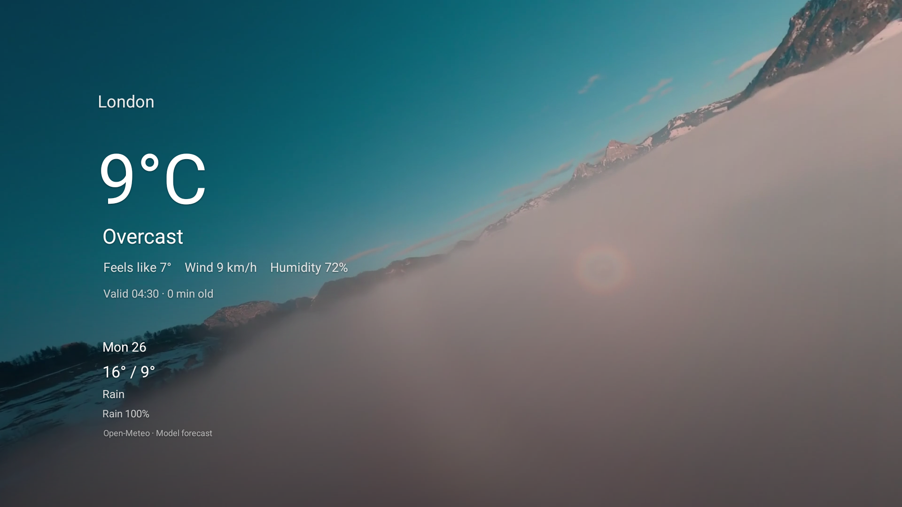
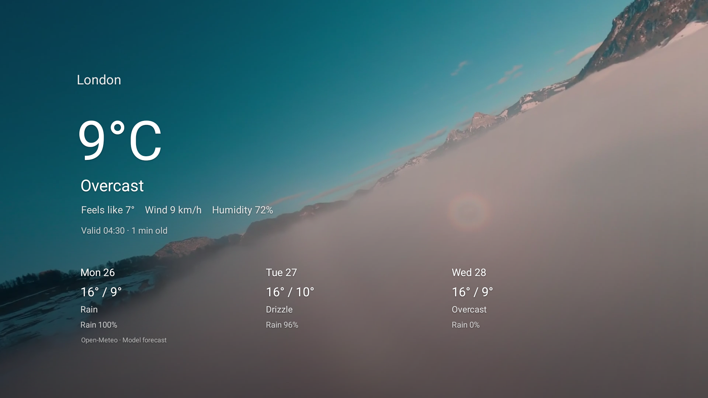
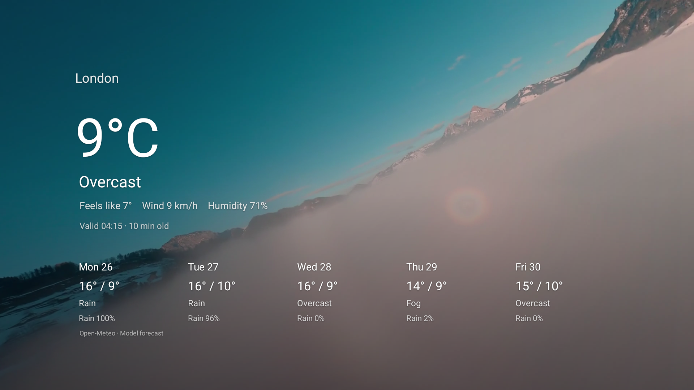
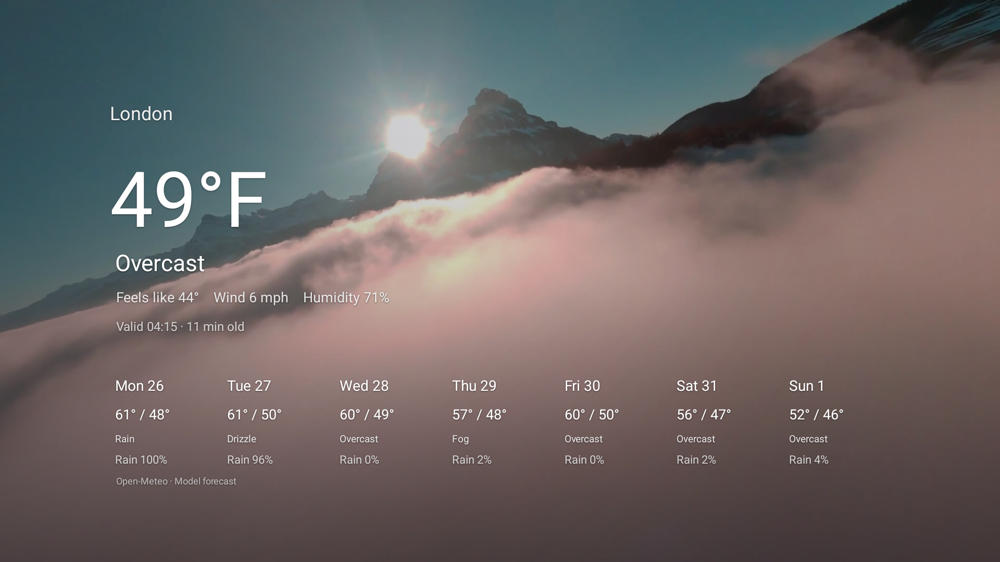
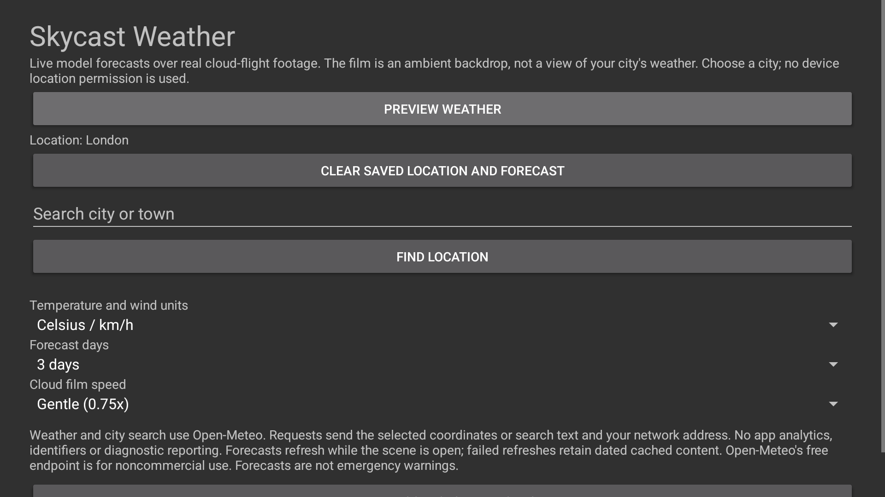
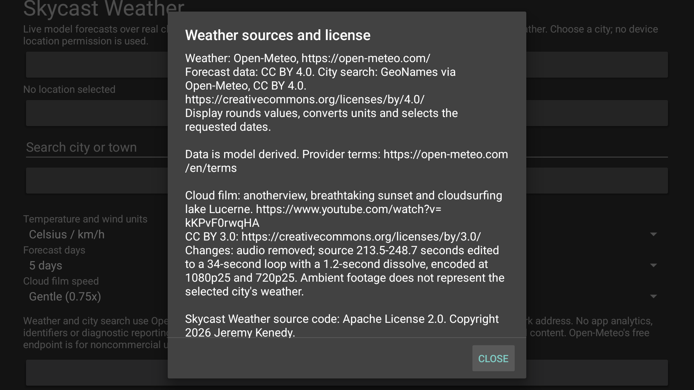

# Native screenshot gallery

Actual Google TV API34 captures at1920x1080 from cinematic candidate3b093626. All weather uses the explicitly selected public London example. These are native previews and settings, with real provider responses; no scene content was retouched. They do not show the owner's private location or establish physical-TV performance. See [capture provenance](../art/screenshots/cinematic-capture-provenance.json).

<table>
<tr>
<td>One day</td>
<td>Three days</td>
<td>Five days</td>
</tr>
<tr>
<td>Seven days</td>
<td>Settings</td>
<td>Sources and licenses</td>
</tr>
</table>

The embedded640x360 preview and320x180 launcher banner are plain resized derivatives of the actual five-day capture. Old volumetric-scene images remain in the repository as historical development artifacts; they do not depict the current background.
