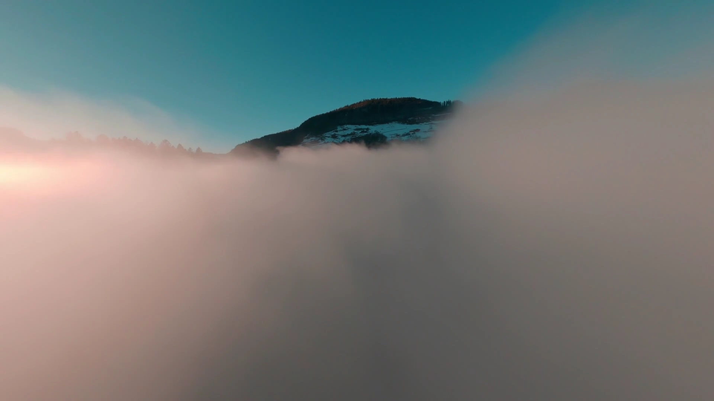
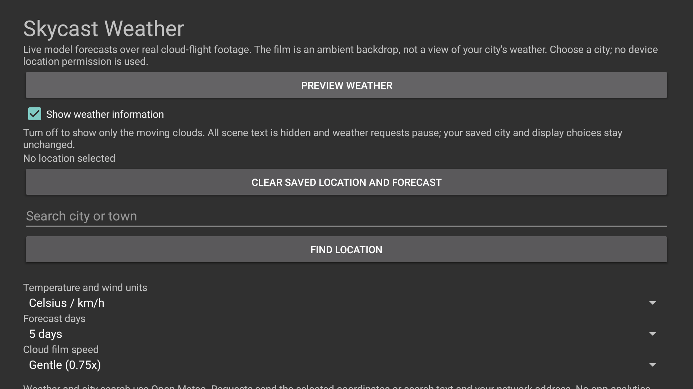
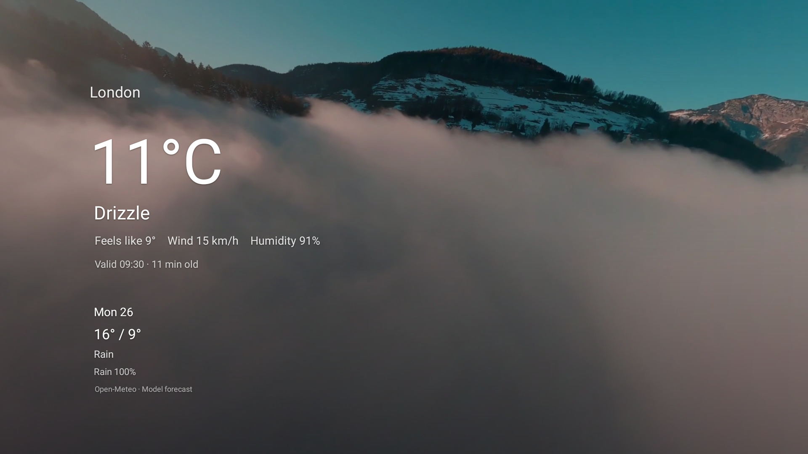
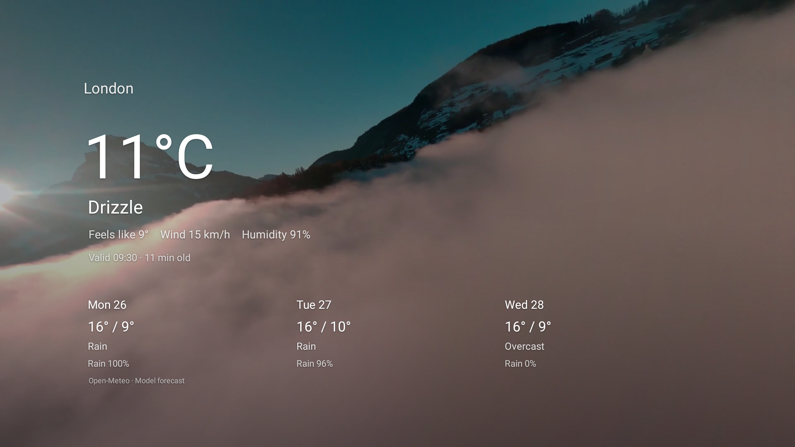
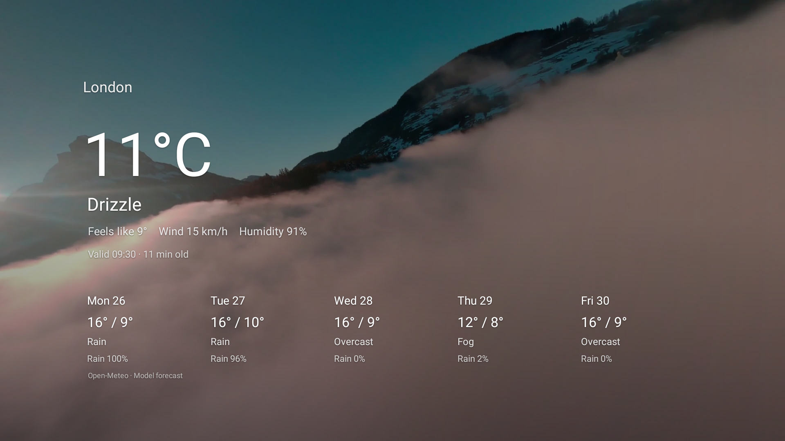
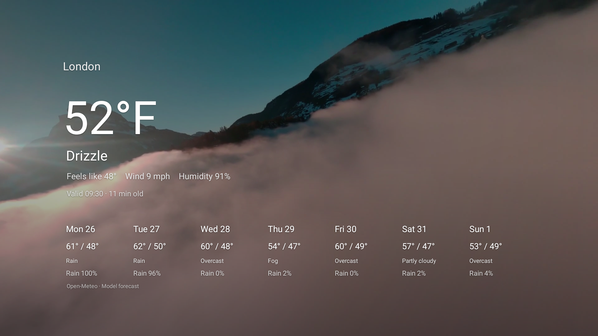

# Native screenshot gallery

Current 1.0.0 / code 4 captures from a physical Fire TV running API 28 on 2026-10-26, 1920x1080. The clouds-only image is an actual normally bound, non-test Dream. Weather layouts use the explicitly selected public London example; settings show the restored no-location default. No scene content was retouched. See [capture provenance](../art/screenshots/physical-code4-provenance.json) and [verification](verification.md).

<table>
<tr>
<td>Clouds only, normal Dream</td>
<td>Settings</td>
<td>One day</td>
</tr>
<tr>
<td>Three days</td>
<td>Five days</td>
<td>Seven days</td>
</tr>
</table>

## Historical source-dialog evidence

The [code 2 API 34 source/license dialog](../art/screenshots/weather-credits-cinematic-api34.png) and its [historical provenance](../art/screenshots/cinematic-capture-provenance.json) remain available separately. Code 4 credits navigation was not proved: bounded native automation failed to produce an XML tree. That is recorded as an unproved check, not a product failure or a new pass.

The embedded 640x360 preview and 320x180 launcher banner remain resized derivatives of the historical code 2 five-day native capture. They show the same filmed scene but predate the new Show weather information setting. Other older volumetric-scene images are historical development artifacts, not the current background.
